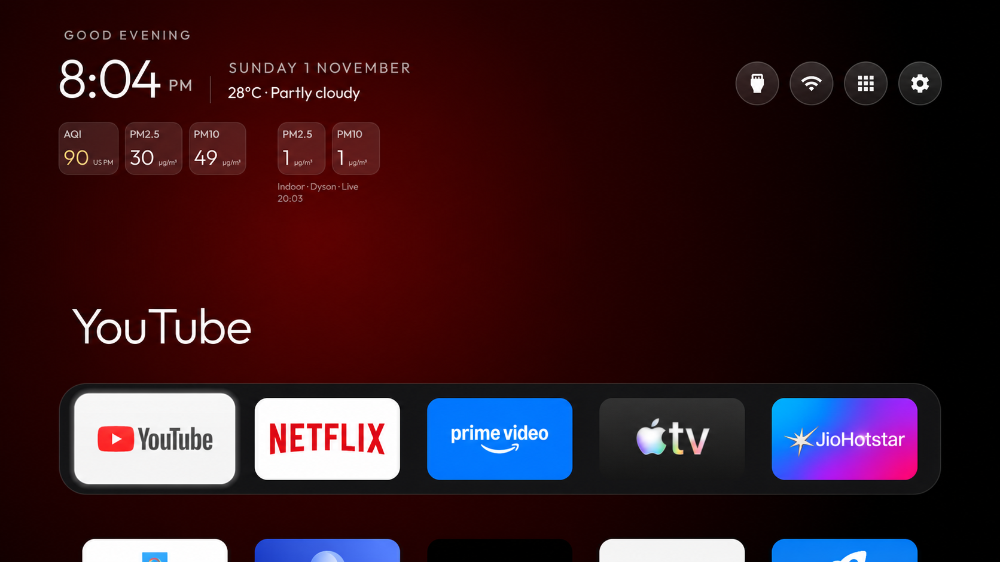

# TV Air Dashboard

An independent source fork of [CleanYourTV](https://github.com/Gathin23/cleanyourtv), adding a compact weather and outdoor/indoor air-quality header. It is not an official CleanYourTV release or a Dyson product.



The image started as a real TV capture of the configured implementation. Its outdoor source caption was removed using image editing for privacy; it is an edited illustration, not an unmodified capture of the blank-default public build. Values are a recorded snapshot.

## Features

- Current temperature and weather conditions beside the clock, using Open-Meteo.
- Three outdoor readouts: calculated US particle AQI, PM2.5 and PM10. The regional particulate observations come from NEA's public data feed, and are 24-hour averages, not readings at an individual home.
- Two indoor readouts: direct, authenticated local-Wi-Fi PM2.5 and PM10 from a Dyson HushJet (product type 897). No indoor AQI is inferred, and no purifier controls are sent.
- Compact neutral glass cards with the units beside the values, plus separate outdoor/indoor source captions.
- Weather requests refresh every 30 minutes while Home is visible, retry after a completed failure, and restart after an interrupted request instead of getting stuck on “Updating”. The selection outline refits when header or tile layouts move.
- No telemetry, ads, cloud bridge or computer that must stay running for normal readings.

## Empty defaults

No weather coordinates, selected reporting region, household/device address, purifier serial, device credential or account country is bundled. Weather and outdoor-air requests stay off until configured. The indoor panel stays hidden until a local connection is provisioned.

The public application ID is **`org.tvair.dashboard`**, separate from the upstream launcher. The inherited Java namespace and module-card identifiers remain compatible with the upstream code. No APKs, signing keys, private configuration, account exports or personal TV backups are distributed here.

## Build

Use JDK 17, Android SDK platform 34 and build-tools 34.0.0. Configure the SDK with your own environment or an untracked `launcher/local.properties`.

```sh
cd launcher
./gradlew --no-daemon testReleaseUnitTest lintRelease assembleRelease
```

The source-built APK is written to `launcher/app/build/outputs/apk/release/app-release.apk`. The project uses the inherited debug-signing configuration for local builds. Do not distribute someone else's signing key.

Install your build with standard Android tooling, then open it as an ordinary app before choosing it as Home. Follow the upstream [TV setup procedure](https://github.com/Gathin23/cleanyourtv/blob/main/PROMPT.md) and its backup, protected-package and Home checks. This project provides no debloat list or replacement installer, and does not require disabling stock Home, the setup wizard or any TV/input service. Keep network debugging off after installation and provisioning.

### Choose weather and outdoor sources

Edit `launcher/app/src/main/res/values/weather.xml` locally before building:

| Resource | Meaning |
|---|---|
| `weather_latitude`, `weather_longitude` | Explicit forecast coordinates you choose. Empty, invalid or non-finite values disable weather requests. |
| `haze_region` | A supported NEA reporting-region key: `north`, `south`, `east`, `west` or `central`. Empty disables regional-air requests. |
| `haze_region_label` | Your own display caption; the generic shipped caption is `Regional`. |

There is no automatic household-location detection or fallback coordinate. Configure these values in your private working copy and do not commit them. The same source file is intentionally blank in the published tree.

NEA is a regional data provider; availability is limited to its reporting areas. Weather is a modelled forecast for the selected point. These two sources do not establish outdoor conditions measured at a particular building. The weather unit is Celsius, and the added header is currently English. Inherited locale-specific layouts without the header continue without it.

### Connect a HushJet

See [private local Dyson setup](dyson-setup/README.md). You enter your own purifier address and account information locally; no shared account or credential is supplied. The TV reads the purifier directly after provisioning. The sign-in helper and computer can then be shut down.

## What the air numbers mean

Outdoor PM2.5 and PM10 are NEA regional 24-hour concentrations in **µg/m³**. The AQI card calculates the greater of the US PM2.5 and PM10 subindices from those concentrations, using the current EPA particle breakpoints and truncation rules. It is labelled **US PM**. It is not NEA PSI, an IQAir reading, a NowCast or an AQI covering other pollutants.

Indoor cards display the purifier's PM2.5 and PM10 sensor values independently. Retained MQTT snapshots, invalid sensors, and explicitly stale/future messages are rejected by the TV reader. No claims are made for temperature, humidity, gases or filter life.

## Network access and permissions

| Access | Purpose |
|---|---|
| `INTERNET` | Optional HTTPS weather and NEA requests; authenticated local MQTT to the configured purifier. |
| `ACCESS_NETWORK_STATE`, `ACCESS_WIFI_STATE` | Inherited network-status control. |
| `ACCESS_FINE_LOCATION` | Inherited optional Wi-Fi-name access on firmware requiring it; the air features do not request location permission or read GPS. |
| `WRITE_SECURE_SETTINGS` | Inherited optional remote-helper recovery; the shell-only, write-only Dyson setup provider is protected by this permission. |
| `yandex.tv.permission.ACCESS_TV_SOURCE` | Inherited TV-source support on YaOS. |
| Accessibility-service binding | Inherited opt-in Home/Input remote helpers can observe window events and filter remote keys. They are not needed to read weather or Dyson data. |
| Notification-listener binding | Inherited opt-in guard/revival helper; not needed by these features. |
| Dream-service binding | Inherited Android clock screensaver, separate from the air features. |

Cloud requests go only to `api.open-meteo.com` (the coordinates you explicitly configure) and `api-open.data.gov.sg` (regional air observations). The optional local sign-in utility sends account credentials only to Dyson's HTTPS app API. Those account credentials and its cloud token are not sent to the TV or stored. The TV's local device credential stays in app-private storage, with Android backup disabled. Local MQTT uses the purifier's plaintext port 1883 inside the private network; keep it on a trusted LAN and never expose it publicly.

Network polling runs only while Home is visible. The inherited optional Home/remote helpers have separate lifecycles. No new boot receiver, location collector, telemetry endpoint or persistent network service was added for the air features.

## Tested scope

The configured feature implementation was checked on a PRISM+ Q55 Ultra 2026 (R10G), Google TV / Android 14, firmware `UKR1.260612.001`, with a HushJet HJ10. Weather and both sets of particle readings were observed on the real TV; the physical Home button, held volume, Input and antenna picture/sound were checked, and the weather/selection fixes were confirmed after a normal restart. Debugging was verified closed after the session.

The public export changes package identity, restores generic launcher defaults and makes geographic sources explicitly unconfigured. Those public-export changes receive unit/build/lint checks; that distinct package has not been installed or made Home on the test TV. No claim is made for several-day stability, other purifier models, HDMI-CEC or other firmware.

## Credits and licence

MIT; see [LICENSE](LICENSE). Based on Gathin23's CleanYourTV launcher at `57c00a40dafe040b0be1f32086e96c05a1a37054`. Original source notices and upstream assets remain attributed to their authors; the inherited Outfit font is covered by its bundled licence notices.

Dyson protocol references: [libdyson-neon](https://github.com/libdyson-wg/libdyson-neon) and the community's [HushJet support work](https://github.com/libdyson-wg/ha-dyson/pull/321). Weather: [Open-Meteo](https://open-meteo.com/). Regional observations: [data.gov.sg](https://data.gov.sg/). Particle AQI: [US EPA breakpoints](https://aqs.epa.gov/aqsweb/documents/codetables/aqi_breakpoints.html). The edited illustration was produced from a TV screenshot with the instruction to remove only the outdoor source-caption line; it contains no selected geographic source label.
